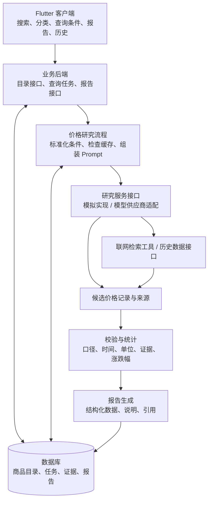

# 商品历史价格趋势应用：架构草案

状态：供产品和实现讨论的第一版设计。后端骨架已使用 Serverpod 初始化，详见
[后端开发说明](../backend/README.md)。双 Tab 演示 UI 已完成，分类卡片和个人页入口
可进入调研页面，并接入后端连接状态。当前已实现购物平台在售价样本调研：
DeepSeek Search/Fetch 仅检索及实时读取京东、淘宝、天猫、拼多多商品页，
Agents SDK 整理证据，后端校验并计算样本均价；无法核验则返回数据不足。
资讯、比价站和转载价格不参与统计；商品页在售价与授权订单成交价分别处理。
已实现最近24个月的区间选择、核验采样持久化、月度趋势/明细及满足条件时的简单线性预测。
平台授权历史数据、商品目录和完整报告持久化仍待实现；目前历史库从查询采样后开始积累。
官方 Agents SDK 已接入独立 TypeScript 服务，并由 Serverpod 桥接，模型使用 DeepSeek。
当前功能范围见 [商品均价说明](current-price-research.md)。接入详情见
[Agents SDK 说明](../backend/agent_service/README.md)。

## 1. 产品目标与主要流程

让用户选择商品或商品类别、时间范围及价格口径，得到可追溯来源的历史价格趋势报告。

```text
搜索 / 浏览分类
  → 选择商品或类别
  → 确认规格、地区、时间范围、价格口径
  → 提交查询
  → 查看检索状态
  → 查看趋势图、涨跌幅、逐年价格、分析与来源
  → 保存到查询历史
```

搜索商品目录与查询历史价格是两个独立步骤。目录搜索应快速返回候选项；只有用户确认条件后才提交价格研究任务。

第一版可维护少量分类、标准商品和别名。搜索不到时允许填写自定义商品，并先补齐影响价格比较的关键条件。

## 2. 查询对象与价格口径

| 查询对象 | 示例 | 比较规则 |
| --- | --- | --- |
| 具体商品 | 某品牌某型号、固定容量的新品 | 保持型号、规格、成色一致；上市前及缺失年份不补造价格 |
| 标准化商品 | 固定等级的大米，统一为元/千克 | 明确等级、地区、渠道和单位，保留原始规格及换算依据 |
| 商品类别 | 手机、家电等一类商品 | 使用明确的统计序列或固定样本篮子；价格指数与实际售价分开呈现 |

“手机价格变化”不能直接用每年不同型号的售价拼接；“某型号手机”也不能用后续型号替代。

每次查询保存以下条件，部分条件可由分类默认值预填并让用户确认：

- 查询对象：类别或具体商品、标准名称、关键规格、成色。
- 市场：国家 / 地区、必要时的城市或渠道、币种。
- 价格类型：零售价、成交价、官方定价等，单份趋势保持一致。
- 时间：明确的起止日期、年度或月度粒度、年度均价或其他明确统计方式。
- 度量：实际价格及单位，或价格指数及基期。

当前实现按自然月展示，提供近3个月、6个月、1年、2年和自定义起止月份，最多24个月且包含本月。
月份按中国大陆时区划分，界面显示具体起止年月；当前月是截至核验时的采样，不能视作完整月统计。

“年度均价”必须有来源提供该统计值，或有符合既定采样规则的数据支持；孤立的一次促销报价只能作为价格观察记录。

地区和币种保留为配置项，初始默认市场在确定首批商品后再定。第一版优先使用同币种序列。

## 3. 整体结构



业务后端采用一个 Serverpod 服务加一个数据库，按模块组织。另有一个小型
TypeScript 进程运行官方 Agents SDK，不直接访问业务数据库。数据库可以先承担
报告缓存和任务状态存储。

| 模块 | 主要职责 |
| --- | --- |
| Flutter 客户端 | 商品选择、条件输入、查询状态、图表、来源链接、历史记录 |
| 商品目录 | 分类、标准名称、别名、规格、可用的查询口径 |
| 查询任务 | 创建任务、状态持久化、超时处理、避免相同请求重复执行 |
| 价格研究流程 | 查询标准化、缓存查找、Prompt 模板、调用研究服务 |
| 研究服务适配层 | 对接模拟数据、模型及检索工具；隔离供应商差异 |
| 价格校验与计算 | 规范单位、检查可比性、识别缺失和冲突、计算涨跌幅 |
| 报告与存储 | 保存价格证据、报告版本、来源及生成时间，支持再次查看 |

模型调用和 Prompt 模板放在后端统一维护，API 密钥也由后端保存。客户端提交结构化查询条件。

## 4. Flutter 内部结构

采用 MVVM：页面负责展示和交互，ViewModel 管理页面状态，Repository 提供商品和报告数据，Service 对接 HTTP 或本地存储。

```text
lib/
  app/                       # 应用入口、主题、路由、依赖组装
  domain/
    models/                  # 商品、查询条件、价格点、报告等业务模型
  data/
    services/                # 后端请求、本地存储、模拟数据服务
    repositories/            # 商品目录、价格报告、查询历史
  ui/
    core/                    # 通用组件、格式化、图表外观
    features/
      catalog/               # 搜索和分类：views/、view_models/
      price_query/           # 选择条件和提交查询
      price_report/          # 检索状态、图表、明细、来源
      history/               # 查询历史
```

页面只依赖 Repository 的约定。开发初期使用模拟实现，后续替换为真实后端实现。复杂且复用的业务逻辑出现后，再按需要增加 use case。

这一分层参考 [Flutter 官方应用架构指南](https://docs.flutter.dev/app-architecture/guide)。

## 5. 一次价格查询的处理过程

1. **确认对象。** 将名称和别名映射到标准对象；若“苹果”等名称存在歧义，先让用户选择，缺少关键规格时先补充条件。
2. **查找缓存。** 用对象、规格、市场、价格类型、单位、日期范围、粒度及统计方式生成查询标识；命中可用报告时展示生成时间，并允许主动刷新。
3. **创建研究任务。** 缓存未命中时返回任务 ID，由后台执行检索；用户可以离开页面后再回来查看。
4. **收集价格证据。** 研究服务使用实际可用的联网工具或历史数据接口，返回结构化候选记录和对应来源。
5. **校验和规范化。** 检查时间、规格、价格类型、单位与引用是否匹配；冲突或信息不足的记录单独标记，不直接混入同一序列。程序校验通过不等同于来源内容已被独立证实。
6. **计算统计值。** 后端按确定的规则聚合和计算；缺失值保留为空，缺失起点或终点时不输出整个所选区间的累计涨跌幅。
7. **生成报告。** 模型基于校验后的数据生成文字说明；Flutter 使用结构化价格序列绘图，并提供每个数据点的来源入口。
8. **保存快照。** 保存查询条件、原始证据、采用的数据、统计规则、Prompt 版本、模型标识及生成时间，刷新时生成新版本。

任务状态建议为 `queued`、`running`、`completed`、`partial`、`failed`。运行中可展示“正在检索来源”“正在整理价格”等阶段；第一版轮询任务状态即可。

研究服务必须具备实际的数据获取能力。以 OpenAI 为例，[Web search 文档](https://developers.openai.com/api/docs/guides/tools-web-search)说明可以启用联网检索并获得来源引用，结果界面需要提供清晰可点击的引用。架构上仍应允许历史数据不足时返回部分结果或无可用数据。

## 6. 核心数据对象

| 对象 | 关键内容 |
| --- | --- |
| Category / Product | 分类、名称、别名、查询对象类型、规格和默认口径 |
| PriceQuery | 规范化后的商品、市场、币种、价格类型、日期范围、统计方式 |
| ResearchJob | 查询 ID、状态、当前阶段、错误原因、关联报告 ID |
| PriceObservation | 原始金额、币种、单位、价格对应日期、商品口径、来源引用 |
| Source | URL、标题、发布机构、发布日期、获取时间、支撑该价格的摘录或证据定位 |
| PriceReport | 查询快照、价格序列、覆盖情况、涨跌幅、摘要、方法说明、版本信息 |

报告价格序列的每个点保存期间、值或空值、单位、统计方式及来源 ID。价格对应日期与网页发布日期分开保存。

累计涨跌幅由代码计算：`(期末值 - 期初值) / 期初值 × 100%`，前提是期初值大于零且两端口径一致。年度同比仅在相邻年度都有可比值时计算。

实际价格与价格指数使用不同的度量类型；结果页分别显示货币单位或指数基期。数据缺口在图表中断开，不能用模型补齐后当作事实展示。

## 7. Prompt 的职责

Prompt 在后端由版本化模板与规范化查询条件组合。基本内容包括：

```text
研究对象：标准名称、对象类型、规格、成色
市场与口径：地区、渠道、币种、单位、价格类型
时间与统计：起止日期、粒度、指定统计方式

要求：
使用可用的检索工具或提供的数据，收集符合上述口径的价格证据。
区分价格对应日期与网页发布日期。
每条记录提供来源 URL、标题、可定位的依据及口径说明。
找不到的数据返回缺失原因，不推测填充价格。
存在不同口径或相互冲突的来源时，分别列出并说明。
按约定 JSON 结构返回候选记录、来源和数据限制。
```

Prompt 用于约束研究任务；结构校验、可比性检查和涨跌幅计算仍由程序承担。报告文字中涉及涨跌原因时，也应附相应证据，推测需明确标注。

## 8. 建议的后端接口边界

后端采用 Serverpod，由 Endpoint 生成类型安全的 Dart 客户端。下表为待实现的业务
调用约定；当前已实现 `client.greeting.hello(...)`、Agent 状态与研究计划接口，
以及 `client.agent.currentPrice(...)` 购物平台在售价调研和
`client.agent.priceHistory(PriceHistoryRequest(...))` 月度趋势接口。后者在 PostgreSQL
保存核验报价，返回逐月采样、来源和满足连续月份条件时的简单预测。

| 接口 | 用途 |
| --- | --- |
| `client.catalog.getCategories()` | 获取分类 |
| `client.catalog.searchProducts(...)` | 搜索 / 浏览商品目录 |
| `client.priceQueries.submit(...)` | 提交条件，返回任务 ID 或已有报告 ID |
| `client.researchJobs.getStatus(...)` | 获取状态、阶段及结果报告 ID |
| `client.priceReports.getReport(...)` | 获取结构化报告、方法说明及来源 |

查询历史第一版可先保存在设备端，记录报告 ID 和查询摘要。账号同步在明确需要后增加。

## 9. 结果页与第一版开发范围

结果页展示：查询对象和完整口径、价格趋势图、可计算的累计涨跌幅、逐年价格及同比、简要解释、逐点来源、数据缺口和报告生成时间。

第一版按以下顺序推进：

1. **页面与模拟数据。** 完成搜索 / 分类、条件选择、查询状态、报告和本地历史；模拟正常、部分缺失、无数据、失败四类结果，所有模拟结果明确标识。
2. **后端与数据约定。** 建立目录、异步查询、报告存储和研究服务接口，先使用模拟研究服务打通流程。
3. **真实数据研究。** 接入选定模型与实际检索能力，用少量人工核对过的商品查询验证来源、口径、缺失处理和计算，再逐步扩展分类。

首批商品优先选择规格容易统一、历史证据可获得的少量品类。模型供应商、默认市场、首批品类和具体价格口径仍是待确定的产品选择。
