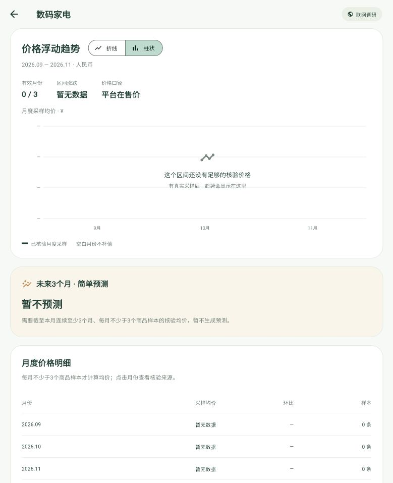
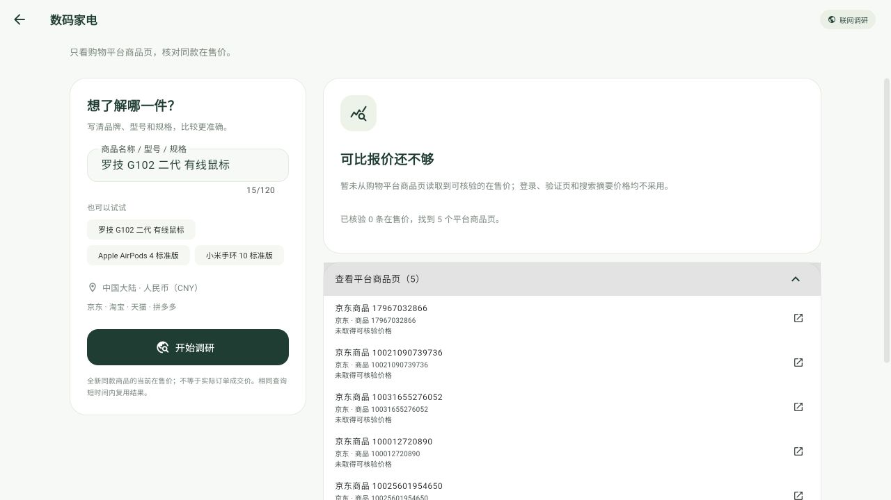

# 商品平台价格趋势与当前在售价调研

入口：首页任一分类 → 填写具体商品 → 选择月份区间 → 开始调研。本地预览：<http://127.0.0.1:8082/>。
点击查询才请求 API，打开页面不自动执行调研。

排查价格为空的实际原因与当前数据权限限制，见[价格读取排查](price-retrieval-diagnosis.md)。
报告会先显示调研状态，区分登录/验证、读取失败和无价格文本，并提供逐平台检索结果。

调研页还提供[平台官方登录入口](platform-login.md)，用于在用户自己的浏览器中查看商品。
该登录状态尚未接入后台自动调研。

## 月份、趋势和简单预测

提供近3个月、6个月、1年、2年，以及自定义起止月份；最多覆盖最近24个自然月（含本月），
默认近6个月。所有月份按中国大陆时区 UTC+8 划分，结束月份不能晚于本月。
客户端和服务端均按明确的起止月份传递查询，不以模型自行理解“最近一年”代替。

趋势支持折线、柱状切换；缺失月份留空，折线在缺口处断开。月度表展示采样均价、
环比和样本数，点击有样本的月份可查看各商品ID、原文、真实采样时间及平台链接。
区间涨跌仅在起止两个月均有合格均价时计算；环比仅比较相邻的有数据月份。

Serverpod 的 `price_observation` 表持久化经过核验的当前平台在售价，使用查询条件、
平台商品ID和实际读取时间去重。缓存命中和并发重复查询不会增加有效样本。
每个月每个平台商品ID只取最后一次采样，异常报价按现有中位数规则剔除；
每月至少3个不同平台商品ID才计算等权采样均价，不能称为整月订单成交均价。

历史库从接入后开始积累。**目前没有授权平台历史数据接口，不能由今日网页还原过去两年的
价格，也不会让模型编造过去月份。** 历史区间不含本月时只读取已有历史采样，不触发今日采价。
当前采样由用户主动查询触发，没有后台定时监控任务。

预测由后端计算：需要截至本月连续至少3个有效月份，取最近最多6个月的采样均价做
普通最小二乘线性回归，外推未来3个月，按分四舍五入。预测值若低于最新价一半或高于两倍，
视为不稳定，不给数值；缺失、过期、零散月份也不预测。预测用暖色虚线或柱形，与核验历史
分别标示。这是简单趋势外推，不包含促销、新品、供需和商家样本变化的因果分析。

## 采价规则

只接受以下平台的商品详情链接，并从链接提取平台与商品 ID：

| 平台 | 接受的商品页 |
| --- | --- |
| 京东 | `item.jd.com/<SKU>.html` 及已支持的 `item.m.jd.com` 商品详情页 |
| 淘宝 | `item.taobao.com/item.htm?id=...` 及已支持的移动详情页 |
| 天猫 | `detail.tmall.com/item.htm?id=...` 及移动详情页 |
| 拼多多 | `mobile.yangkeduo.com/goods*.html?goods_id=...` |

平台的资讯页、搜索列表、优惠跳转链接不算商品页。中关村在线、什么值得买、慢慢买、
新浪等第三方页面不参与采价，即使它们引用了“京东价”或“天猫价”。伪装平台域名也会被排除。

搜索仅用于发现商品链接，搜索摘要、缓存正文和搜索日期均不作为价格证据。
所有候选商品页都必须实时重新读取。需要登录、验证码、页面不可读、价格隐藏或仅有参考价时，
不采用对应报价；不会退回资讯站或模型记忆补齐。

只比较中国大陆 CNY、同型号同规格全新商品的具体在售价。排除原价、参考价、划线价、
建议零售价、起售价、价格区间、个人优惠、会员/新人/国补、拼团条件、预售定金、分期月供、
企业采购、二手和捆绑套装。商家名必须能在实际原文中核对，否则只标注平台名。

每条价格必须与实时正文中的短原文和金额一致。服务端也检查金额所在字段附近的上下文，
避免模型仅摘录数字而隐去“参考价”“会员价”等条件。同一平台商品 ID 最多采用一条，
PC/移动页和推广跟踪参数不会形成重复样本。可确认商家的相同报价也会去重。

至少3条合格报价才计算均价，按“分”等权计算并四舍五入。候选至少3条时，暂不采用超出
中位数÷2.5至中位数×2.5的异常报价。该规则是原型检查，不能单独保证价格真实性。
报价不足时返回 `insufficient_data`，均价和区间为 `null`，可保留平台商品链接供用户核对。

## 在售价与成交价

当前显示的是**平台商品页在售价样本均价**，不是已验证的真实订单成交均价。
目前没有接入任何授权订单流水；实际支付金额可能随规格、地区、账号及优惠条件变化。
要统计真实成交价，需要接入有权限的订单/交易数据，并明确 SKU、时间和价格口径。
大模型负责整理证据，不充当交易数据库。

旧版示例中的92.60元来自第三方报道，已不符合当前规则，不能作为现行有效报价。
旧报告缓存已清除，缓存键包含采价策略版本 `platform-product-v2`。

## 调用链

```text
Flutter 页面 / ViewModel → Repository / ServerpodService
  → client.agent.priceHistory(PriceHistoryRequest)
  → Serverpod 校验最近24个月区间
  → 含本月时，调用 POST /v1/market-price 采集当前报价
  → DeepSeek Search：按四个平台分别检索，每个平台最多5个结果
  → 严格校验详情链接与商品ID，交错选取最多6个商品页
  → DeepSeek Fetch：实时读取每个候选页
  → Agents SDK + DeepSeek：仅从可读平台页整理证据
  → 服务端再次校验平台、时效、价格字段、去重及均价
  → Serverpod 保存有效报价快照 / 读取历史区间
  → 按月汇总、计算涨跌幅和有足够依据时的简单预测
```

没有可读的价格证据时不调用模型生成价格。部分平台检索失败时，可继续处理其他平台结果；
所有检索失败则返回服务错误。密钥只由后端 `.env` 读取，不进入 Flutter 或 Web 构建。
旧 `currentPrice(MarketPriceRequest)` 接口继续提供单次当前报价；新增趋势接口组合采价与历史库。
新增数据库迁移 `20261117145332670`，启动时通过 `--apply-migrations` 应用。

## 返回及缓存

报告包含状态、均价/区间、样本数量、商品页数量、报价原文、口径、限制、核验时间和缓存标记。
来源另含 `platform`、`productId`、`fetchedAt`，界面展示平台、商品ID与读取状态。
`fetchedAt` 是读取时间，不是成交时间，也不意味着该页面中的价格已被采用。

成功结果缓存10分钟，报价不足或需要澄清的结果缓存2分钟，时间戳保留原核验时间。
报价快照持久化在 PostgreSQL；时间区间的月度结果每次从快照计算，不缓存历史曲线。
完整报告、查询记录和授权订单数据同步尚未实现。模型服务暂不可用时，仍能显示已有历史采样。

## 检查

```sh
bash backend/tool/agent.sh test
.fvm/flutter_sdk/bin/flutter analyze --no-pub
.fvm/flutter_sdk/bin/flutter test --no-pub
cd backend/goods_search_server
../../.fvm/flutter_sdk/bin/dart test test/unit test/integration
```

自动化测试使用替身，不消耗 API 额度。真实调研会消耗 DeepSeek 搜索/抓取及必要的模型额度。
覆盖平台详情路由与伪装域名、第三方引用价拒绝、参考价/条件价、搜索摘要禁用、强制实时读取、
登录页、商品ID去重、过期读取、金额计算、缓存、序列化及页面无可核验价格时的显示。
趋势测试另外覆盖24个月限制、自定义反向月份、UTC+8月界、缓存报价入库去重、按月汇总及
缺失月份、线性预测数值、拒绝不稳定预测、真实 PostgreSQL 存取和不同屏幕尺寸。

## 2026-11-17 趋势功能验证

21项 Node 测试、18项 Serverpod 单元/集成测试和13项 Flutter 测试通过，共52项。
静态分析无问题，Web 构建成功；开发与测试数据库均已应用新增迁移。
浏览器验证近2年区间、自定义起止月份、真实 API 提交、折线/柱状切换、月度明细和预测状态。
真实查询罗技 G102 二代有线鼠标（2026.09—2026.11）仍未取得可核验在售价，
3个月均为空值，预测明确显示“暂不预测”。测试中的历史数据只写入独立测试库并自动回滚，
没有在开发库中插入假价格以形成曲线。iOS/Android 本轮未做设备构建验证。



## 2026-11-16 验证

21项 Node 测试、8项 Serverpod 桥接单元测试、9项 Flutter 测试通过；静态分析无问题，Web 构建成功。
真实查询罗技 G102 二代有线鼠标找到5个京东商品页，但未取得可核验的在售价；
返回 `insufficient_data`、0条有效报价、空均价，界面保留商品ID和详情链接。
没有退回使用资讯转载中的金额，也没有把网页价格标记为实际成交价。
iOS/Android 本轮未进行设备构建验证。


