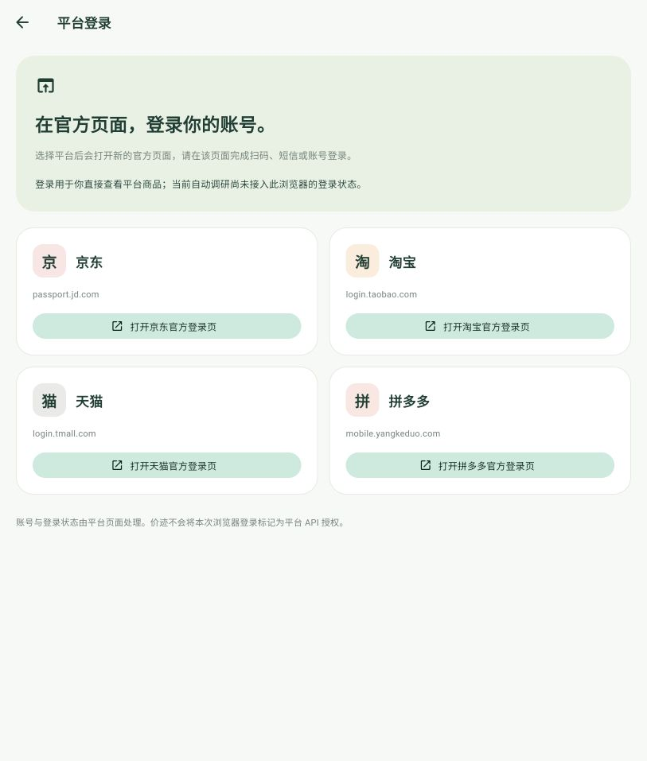

# 平台官方登录入口

2026-11-18：已在商品调研页右上角、需要登录的调研结果，以及“我的 → 平台登录”提供入口。
可打开京东、淘宝、天猫、拼多多的官方登录页面。

## 当前行为

- Web 预览通过用户点击打开新的官方页面，保留当前调研页。
- iOS / Android 使用已有 `url_launcher` 的应用内浏览器模式，系统不支持时按插件规则回退。
- 在平台官方页面中自行完成扫码、短信、密码及平台验证。
- 从调研结果进入时，会带上已发现的商品链接。登录后可用同一浏览器打开这些商品页，
  直接核对商品规格和在售价。可打开的商品链接仍限定为支持的平台详情页。
- 打开页面只显示“已请求打开”，没有将用户标记为已登录、已授权或已连接平台 API。
  Web 浏览器可能阻止弹出窗口，客户端无法可靠检测，页面提示允许弹出后重试。

URL 打开方式参考 [url_launcher 文档](https://pub.dev/packages/url_launcher/versions/6.3.2)。
应用没有自建平台密码表单，也没有读取或向 Serverpod、模型服务发送平台浏览器 Cookie。

## 自动采价仍需继续接入

平台登录只作用于用户打开的浏览器页面；当前后端的 DeepSeek Search/Fetch 是独立请求。
[Fetch 接口](https://api-docs.deepseek.com/api/fetch/)的请求字段为 URL，
不能直接传入这里的浏览器会话。因此，登录入口尚未打通自动采价，不承诺登录后点击
“开始调研”即可取得报价，也不能通过登录恢复历史月份的数据。

后续若采用登录会话采价，需要单独实现同一会话中的商品读取、明确允许传输的数据范围，
并继续核验商品、价格口径、时间和来源；也可接入有权限的平台商品或历史数据接口。

## 验证

21项 Flutter 测试通过，覆盖官方链接限制、伪装域名/执行链接拒绝、重复点击、页面关闭、
打开失败、真实商品链接传递、登录与授权状态的区分，以及320px/横屏/宽屏布局。
测试不输入真实账号，不发送短信、不完成登录或验证码验证。

Web 构建成功；浏览器已实际点击京东入口，确认新标签页地址为
`https://passport.jd.com/new/login.aspx`，显示京东官方登录表单。

同时修正了本地旧 Web 构建缓存遗漏 `url_launcher_web` 注册的问题：失效化生成的
`web_entrypoint.stamp` 后重建，确认生成注册文件包含 `UrlLauncherPlugin.registerWith`。
没有手动修改生成的注册文件。以后添加 Web 插件后若出现类似缓存问题，需清理 Web
构建缓存并重新构建，不能仅依赖已有的入口生成缓存。

Android 原生构建未完成：现有 `connectivity_plus` 的 AGP 8.12.1 构建依赖下载阶段长时间
未结束，已停止该次在线构建；离线复核确认缺少对应依赖缓存。本轮没有生成新的 APK，
iOS / Android 均未进行设备上的真实账号登录验证。

