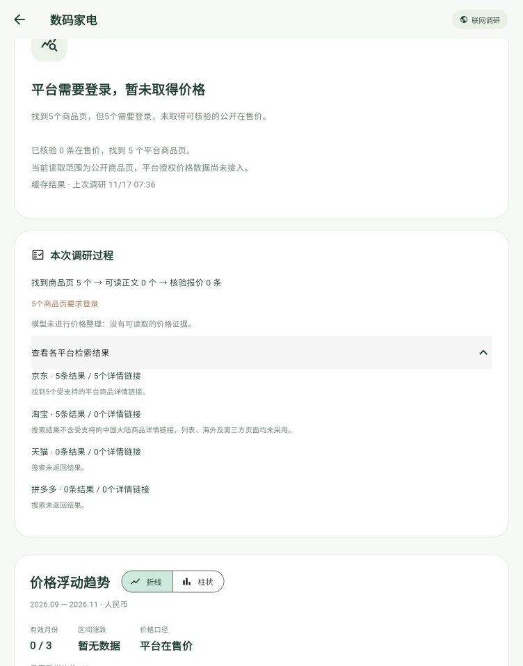

# 未取得商品价格的排查记录

日期：2026-11-17。复测商品：罗技 G102 二代有线鼠标，中国大陆，人民币。

## 实际调用结果

| 环节 | 结果 |
| --- | --- |
| DeepSeek 模型推理 | HTTP 200，正常返回回复，模型配置和密钥可用 |
| 京东站点搜索 | HTTP 200，5个商品详情链接 |
| 京东详情读取 | 5次 HTTP 200，实际正文均是“京东-欢迎登录”，无价格 |
| 淘宝站点搜索 | HTTP 200，5条列表或海外链接，没有受支持的大陆商品详情链接 |
| 天猫、拼多多站点搜索 | HTTP 200，当前查询没有返回结果 |
| 价格证据整理 | 没有合格正文，不调用模型生成价格 |
| 月度趋势与预测 | 无有效报价快照，返回空价格和数据不足 |

另外检查了同一京东商品的公开移动详情页，能够读到部分商品信息，但价格是
“¥2?? / 登录查看价格”；页面中的“￥0.00”出现在定期购、运费等其他区域。
这些不是可以采用的商品在售价。

HTTP 200 只说明网页读取请求成功，不能证明返回的是商品正文，更不能证明取得了价格。
[DeepSeek Search](https://api-docs.deepseek.com/api/search/) 返回网页检索结果，
[Fetch](https://api-docs.deepseek.com/api/fetch/) 返回网页标题和 Markdown 正文；
当前调用没有京东、淘宝、天猫或拼多多的登录状态、商品数据授权或订单数据权限。

## 本次修正

- 原先读取异常被统一吞掉，来源只显示“未取得可核验价格”。现在记录并返回登录、验证、
  不可用、无价格、空正文、超时、读取失败、响应格式异常等状态；只返回安全的原因，
  不把供应商响应原文或密钥发送到客户端。
- 报告增加四个平台的检索结果数、详情链接数、可读页数、候选证据页数和模型是否执行。
- 先展示价格获取状态和调研过程，再展示趋势，避免空图掩盖实际失败原因。
- 加强移动页“登录查看价格”识别，禁止使用遮罩价格或其他区域的费用作为商品报价。
- 核验来源逐条显示访问原因；无报价结果若来自缓存，会注明缓存和上次调研时间。

本次没有接入新的平台授权数据源，也没有放宽来源规则或填充虚构价格。
要获得稳定、可核验的商品价格，需要接入有权限的购物平台商品数据；历史成交价还需要
相应的历史或订单数据。修改 Prompt 不能解决网页登录限制或数据授权缺失。

## 验证

24项 SDK/HTTP 测试、18项 Serverpod 单元/集成测试、14项 Flutter 测试通过，
共56项；静态分析无问题。测试覆盖登录页、移动遮罩价格、超时和错误分类、诊断字段
传递、原均价和时间区间逻辑，以及错误原因先于图表展示。模型推理和商品检索/读取
另外使用真实 API 验证，未将测试价格写入开发库。

